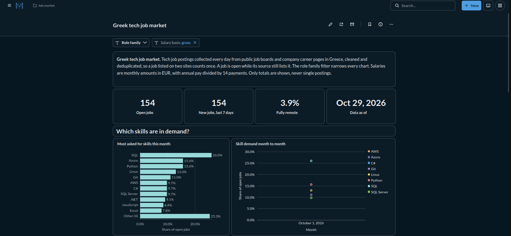
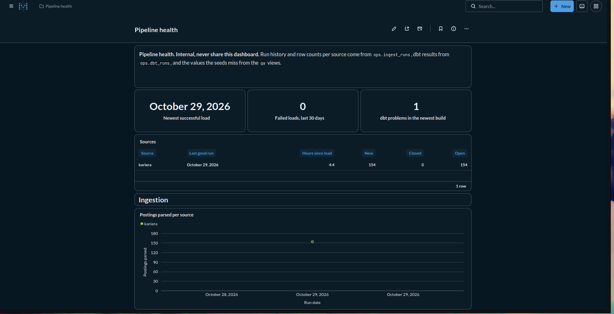
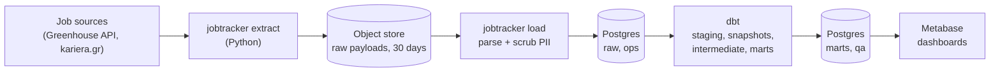

# Greek Tech Job Market Tracker

A self-hosted data pipeline that collects Greek tech job postings every day,
cleans and deduplicates them, and publishes a dashboard of what the market
looks like: which skills are in demand, who is hiring for which roles, how
much remote work there is, what people get paid and how long postings stay
open.

I started this because there is no simple way to see the Greek tech job
market as a whole. Job boards show one posting at a time, in two languages,
with salaries quoted per month, per year over 14 payments, net or gross, or
not at all. The same job often shows up on more than one site. I wanted
something that turns that into a few honest numbers that a student or a
junior engineer can actually use, and I wanted to build it the way a real
data platform would be built: scheduled, tested, monitored and rebuildable
from raw data.

## Screenshots

The public dashboard:



The internal pipeline health dashboard:



## What the dashboard answers

1. Which skills appear most often, month to month?
2. How many new postings are there per week, by role family?
3. What share of jobs are remote, hybrid or on-site, by city?
4. How does demand split by seniority?
5. What are the salary ranges by role and seniority?
6. How long do postings stay open?

Only aggregates are published. The dashboard never shows a single
posting's text, company or link.

## How it works



Airflow runs the whole thing once a day at 06:00 Athens time:

1. **Extract.** One task per source fetches the listing pages and the
   details of new or changed postings, and saves every response as is in
   an S3-compatible object store (Garage). Unchanged postings are not
   fetched again.
2. **Load.** A parser per source turns the saved payloads into typed rows,
   removes emails, phone numbers and contact names, and appends them to
   `raw.raw_postings` in Postgres. Raw rows are never updated.
3. **Transform.** dbt builds the warehouse layer by layer. Staging
   normalizes text and classifies each posting (city, work mode,
   seniority, role family, salary). Intermediate works out when postings
   open and close, extracts skills and merges duplicate postings into
   jobs. The marts are the tables the dashboard reads.
4. **Test and publish.** Every layer runs its tests before the next one
   builds. If anything fails, the marts are not touched and the dashboard
   keeps showing the last good day.
5. **Report.** Failures and retries alert to Discord (with email as a
   fallback), a summary of new, open and closed postings goes out at the
   end of each run, and a watchdog alerts if the run has not succeeded by
   10:00.

## Stack

| Layer | Tool |
| --- | --- |
| Ingestion | Python 3.12, requests, BeautifulSoup, Pydantic, structlog |
| Orchestration | Apache Airflow 3 (LocalExecutor) |
| Raw storage | Garage, an S3-compatible object store |
| Warehouse | PostgreSQL 17 with `pg_trgm` and `unaccent` |
| Transformation and tests | dbt Core with dbt-postgres |
| Dashboards | Metabase, defined as JSON and SQL files |
| Deployment | Docker Compose, one `make up` for the whole stack |
| Tooling | uv, ruff, mypy, sqlfluff, pre-commit, gitleaks, GitHub Actions |

Every piece is open source and self-hosted, and each one has an obvious
managed equivalent (S3, RDS, MWAA, and so on). The code only talks to
storage through the S3 API, so moving it would be a configuration change.

## Design choices

A few decisions shape most of the code.

**Scraping politely.** All HTTP goes through one shared client that sends
an identifying User-Agent, waits at least 3 seconds between requests to a
host, respects robots.txt and `Retry-After`, and stops the source for the
day on a 401, 403, CAPTCHA or login wall instead of trying to get around
it. A source is only enabled after I have read its terms and robots.txt.
One Greek job board was dropped at that step because its terms ban bots.

**Raw data is immutable and replayable.** Payloads are kept for 30 days and
parsed rows forever. When a site changes its HTML and a parser breaks, I
fix the parser, bump its version and run a reparse DAG over the stored
payloads, without hitting the site again. Everything after
`raw.raw_postings` can be rebuilt with `dbt build --full-refresh`.

**Python fetches, dbt decides.** Python only fetches and parses. Every
business rule (normalization, classification, salary parsing, skill
matching, deduplication, metrics) lives in dbt, and the dictionaries and
keyword rules behind them are CSV seeds. Teaching the pipeline a new city
spelling or a new skill means adding a row and a test, not changing code.

**Greek text is handled on purpose.** Text is lowercased and stripped of
accents, and the Greek final sigma is folded into the regular one, before
anything is matched. City names are matched in Greek and Latin spellings,
Attica suburbs map to Athens, and annual salaries are divided by 14 because
that is how Greek pay is usually split. Values that no rule covers land in
`qa_*` views, so the seeds grow from real data.

**Deterministic deduplication.** Postings from the same company with
matching titles, close first-seen dates and compatible city and seniority
are paired, and pairs are joined into clusters. Each cluster's `job_id` is
the key of its earliest posting, so a full refresh always produces the same
ids.

**A broken scraper should not lie.** A posting only closes after it is
missing from two successful runs of its source, and failed runs do not
count, so a scraper that breaks overnight does not close every job. A
volume test fails the build when a source suddenly returns less than half
its usual number of rows.

**Dashboards are code.** Metabase's own export is a paid feature, so both
dashboards are JSON and SQL files that a small script applies through the
Metabase API. CI checks the layout and runs every dashboard query against
freshly built marts, so a mart change that would break a chart fails the
build.

**Least privilege.** Each part of the stack uses its own Postgres role:
the loader can only write `raw` and `ops`, dbt can only read those and
write its own schemas, and Metabase reads through a role that sees `marts`,
`qa` and `ops` and nothing else.

## Data sources

| Source | Kind | How it is read |
| --- | --- | --- |
| Greenhouse job boards | ATS | Public Job Board JSON API, for a curated list of companies |
| kariera.gr | Greek job board | HTML pages, using the schema.org JSON-LD embedded in each posting |

Sources are listed in [`config/sources.yml`](config/sources.yml), with the
date their terms and robots.txt were reviewed. Adding a source means
writing one adapter, one registry entry and its test fixtures; the DAG
picks it up on its own. The kariera.gr fixtures in the repo are made up,
because the site's terms do not allow passing its content on.

## Running it locally

You need [uv](https://docs.astral.sh/uv/) (it installs Python 3.12 for
you), [pre-commit](https://pre-commit.com/), Docker with the Compose plugin
and GNU Make.

```sh
git clone https://github.com/Turtel216/greek-job-market-tracker.git
cd greek-job-market-tracker
cp .env.example .env    # fill in the passwords and keys; each one says how to generate it
make setup              # dev dependencies, dbt and git hooks
make up                 # Postgres, Garage, Airflow and Metabase
```

Then open Airflow at <http://localhost:8080> (user `admin`) and Metabase at
<http://localhost:3000>. Unpause `jobtracker_daily` to start collecting.

To see the transformation layer work without scraping anything, build the
dbt project against a throwaway Postgres loaded with a made-up sample of
postings:

```sh
make test-dbt
```

`make help` lists every target. Day to day operation, including how to
backfill a parser fix, is described in [docs/operations.md](docs/operations.md).

## Testing

Tests run offline, against saved pages and a made-up sample of postings, so
the suite never touches a real website.

- Parser tests compare each adapter's output on saved pages with the
  expected JSON. Every parser change ships with a fixture.
- Unit tests cover the HTTP client (rate limits, retries, robots.txt, block
  detection), PII scrubbing and the loader, with the loader also tested
  against a real Postgres.
- dbt unit tests check normalization, salary parsing, classification,
  skill patterns, lifecycle and deduplication with real Greek and English
  examples, and data tests check keys, relationships, accepted values,
  volume and the mart contracts.
- DAG tests check the task graphs, alerts and schedules, and that the dbt
  steps build every model and test exactly once.

```sh
make lint test test-db test-dags test-metabase test-dbt
```

GitHub Actions runs lint, a secrets scan of the full history, the Python
tests with an 85% coverage floor, the database tests and the full dbt build
on every pull request.

## Status

The pipeline, the warehouse and both dashboards are built and tested
locally. Still to do:

- Deploy to a server behind HTTPS (Caddy) and publish the dashboard.
- Nightly backups with a tested restore.
- Run unattended for four weeks on both sources, which is my definition of
  done for the first version.
- Score deduplication on hand-labeled real postings. It currently reaches
  the 95% precision target on a made-up sample only.

Ideas for later include more sources, LLM-assisted skill and seniority
extraction, and a public export of the aggregated data.

## Repository layout

| Folder | Contents |
| --- | --- |
| `config/` | Source registry (`sources.yml`) |
| `ingestion/` | Python package `jobtracker_ingest`: HTTP client, source adapters, loader and CLI |
| `dags/` | Airflow DAGs and their shared code |
| `transform/` | dbt project: models, seeds, macros, snapshots and tests |
| `metabase/` | Dashboard definitions and the provisioning script |
| `infra/` | Airflow Dockerfile, Postgres init scripts, object store setup |
| `scripts/` | Test helpers and the dedup sampling scripts |
| `tests/` | DAG, Metabase and dedup sample tests |
| `docs/` | Operations guide |

## Further reading

- [docs/operations.md](docs/operations.md): running, changing and debugging
  the pipeline
- [ingestion/README.md](ingestion/README.md): the ingestion CLI

## License

MIT
